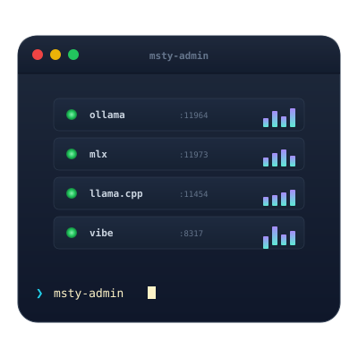
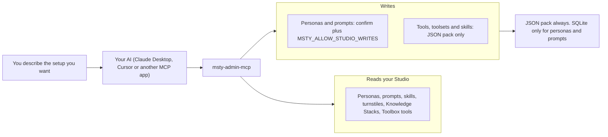
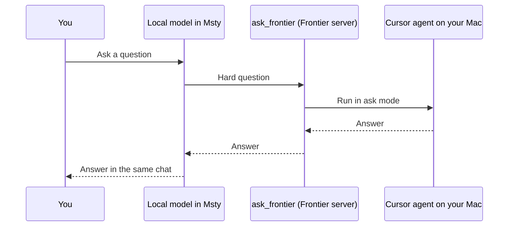
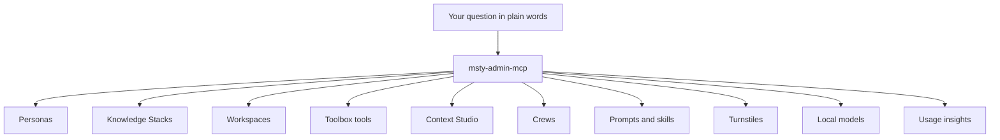

<div align="center">



# Msty Admin MCP v6.2.0

[](LICENSE)
[](https://www.python.org)
[](https://github.com/M-Pineapple/msty-admin-mcp/stargazers)
[](https://glama.ai/mcp/servers/M-Pineapple/msty-admin-mcp)

</div>

> Unofficial community project. Not affiliated with, or endorsed by, Msty. Msty is a trademark of its owner.


**Let the AI you already use plan, check and look after your local AI in Msty Studio, and let your local model ask for stronger help only when it needs it.**

## What this does

Msty Studio lets you run AI models on your own Mac. Msty Admin MCP connects that setup to an AI app that supports MCP, such as Claude Desktop or Cursor. That AI can size your machine, recommend and install a local model that fits, test it, write personas and prompts into Studio when you allow it, and keep an eye on usage, cost and health. Tools, toolsets and skills are saved as a JSON pack for Toolbox import. A separate small server, Frontier, lets a local model in a Msty chat pass a question it cannot handle to Cursor, Grok, or Claude, and the answer comes back into the same chat.

**What it changes, in brief.** Inventory and analytics stay read only. Studio SQLite writes need `confirm=true` and `MSTY_ALLOW_STUDIO_WRITES=1` in the server environment. Tools, toolsets and skills never go into SQLite from this MCP. Keys, tokens and passwords are redacted. Details are in [Security and data access](#security-and-data-access).

## The hybrid setup

1. **Recommend.** Your AI reads hardware (chip, RAM, Apple generation) and suggests a Q4 model that fits. Recent Studio usage wins when that model still fits.
2. **Set up.** `install_model` pulls through Local AI (`/api/pull`) when you pass `confirm=true`. MLX and llama.cpp still download in Msty.
3. **Test.** Your AI runs calibration prompts, compares models side by side on the same prompt, and can run Bloom behaviour checks such as sycophancy when Bloom and an Anthropic key are present.
4. **Tune.** `set_model_settings` creates an Ollama Modelfile variant (`/api/create`) with temperature, top_p, context length and system prompt. Pass `confirm=true` to apply.
5. **Configure Studio.** `generate_persona`, `import_tool_config` and `import_studio_pack` always save a JSON pack under `~/.msty-admin/imports/`. Tools, toolsets and skills stay in that pack for Toolbox import. Personas and prompts insert into Studio only with `confirm=true` and `MSTY_ALLOW_STUDIO_WRITES=1`, after a backup, and they refuse while Studio holds the live DB.
6. **Work locally.** You chat with your local model in Msty as usual.
7. **Escalate.** When a question is too hard, the local model calls `ask_frontier` or `escalate_if_needed`. Cursor is the default. Grok (`XAI_API_KEY`) and Claude (`ANTHROPIC_API_KEY`) are also available. Msty Studio has no hook API. The escalation persona is the honest equivalent.


### Your AI as the architect



### A local chat asking for help



The local model must make a real tool call, and the chat must use a toolset that contains only the Frontier server. Cursor answers with your Cursor account, so you need a Cursor user API key. See [Caveats](#caveats).

## What you can do

Once the server is added to your AI app, type requests as you normally would. The AI picks the tool. The groups below cover the 61 tools that exist. The full names are in [Tools summary](#tools-summary-61-in-total).

### Know your machine and pick a model

The server reads chip, RAM and GPU, then recommends a Q4 model that fits, preferring a model you already use when it still fits.

- "What hardware is this Mac, and which local model fits?"
- "Recommend a model for summarising long documents."
- "Which local models do I have, and are Local AI, MLX and llama.cpp running?"

### Install and tune local models

`install_model` pulls through Local AI after `confirm=true`. `set_model_settings` creates a Modelfile variant. MLX and llama.cpp still download in Msty. You can also chat with those services from here.

- "Install llama3.2:3b on Local AI."
- "Make a cooler variant of that model with temperature 0.2."
- "Chat with this local model / MLX model / llama.cpp model."

### Keep Msty healthy

Health, install detection, service ports, MCP status, provider config (keys redacted), schema migrations, and a read-only Claude Desktop to Msty tool delta.

- "Is my Msty install healthy, and which version is it?"
- "What is the MCP server status?"
- "Show the delta between my Claude Desktop MCP servers and Msty Toolbox."

### See what is in Studio

Read-only inventory of workspaces, personas, crews, Knowledge Stacks, turnstiles, prompts, skills, Context Studio, agent plans and Toolbox tools. Export a workflow pack. Get one entity by id.

- "List my personas, knowledge stacks and workspaces."
- "Show the tools in my Toolbox and export one config."
- "Export a workflow pack for this workspace."

### Bring personas, prompts, skills and tool configs into Studio safely

Every write tool saves a JSON pack under `~/.msty-admin/imports/`. Personas and prompts insert into SQLite only with `confirm=true` and `MSTY_ALLOW_STUDIO_WRITES=1`. Tools, toolsets and skills stay in the pack for Toolbox import. Configs with `command`, `args` or `env` are flagged as running a program on your machine.

- "Write a persona called Research Assistant into Studio."
- "Save this tool config as a pack I can import in Toolbox."
- "How could my personas and Knowledge Stacks be better?"

### Compare, calibrate and Bloom-evaluate

Side-by-side answers, built-in calibration prompts, a quality score on a single reply, and Bloom behaviour checks when Bloom and an Anthropic key are present. Bloom invents no score.

- "Compare qwen2.5 and mistral on this prompt."
- "Test llama3.2 on reasoning and coding."
- "Run a Bloom evaluation for sycophancy on this model."

### Escalate to Grok, Claude or Cursor

From a local-model chat that uses the one-tool Frontier server, a hard question can go to Cursor (default), Grok or Claude and the answer comes back in the same chat. `escalate_if_needed` is the gated form. See [Hybrid local model and Cursor agent](#hybrid-local-model-and-cursor-agent).

- "Ask Grok why this SwiftUI view is not updating."
- "Ask the Cursor agent on this Mac."
- "Should this question be handed off?"

### Usage insights and cost

Studio insights give tokens, speed and `totalCostInUSD` per model. Conversation patterns sit next to that.

- "Show model performance metrics and cost for the last 7 days."
- "Analyse my conversation patterns."
- "What did I use on Nexus, and which models does it expose?"

### What it can see in Studio



## Who this is for

Msty Studio users who want their usual AI app to help choose, test and organise their local models, and who want local models to call on a stronger agent only when a question is beyond them, without leaving the chat. You do not need to know how MCP works beyond adding a server to your app.

## Security and data access

- Inventory, analytics and free-form SQL stay **read only**. Credential columns always read as NULL. Secrets typed into free text, such as a chat message or a note, are out of scope.
- Write tools always save a JSON pack under `~/.msty-admin/imports/` (mode `0600`, directory `0700`). `import_tool_config` and the tools, toolsets and skills keys of `import_studio_pack` never write the Studio database. Import that pack in Toolbox. Configs with `command`, `args` or `env` are flagged as running a program on your machine.
- Personas and prompts insert into Studio SQLite only when both `confirm=true` and the operator env `MSTY_ALLOW_STUDIO_WRITES=1` are set. The LLM cannot set that env through a tool argument. Writes take a SQLite backup (including WAL) under `~/.msty-admin/backups/` and refuse while Msty Studio is running against the live database. Tests use fixture copies, never the live DB.
- `query_local_ai_service` is allow-listed (tags, version, show, chat). Pull and create go through `install_model` and `set_model_settings`, which also need `confirm=true`.
- Calibration and Bloom history live under `~/.msty-admin/`, not in Studio.
- Frontier needs `CURSOR_API_KEY` for Cursor, `XAI_API_KEY` for Grok, or `ANTHROPIC_API_KEY` for Claude. Keys stay in Msty's toolbox environment and never belong in this repository. In ask mode the Cursor agent does not send mail, move or delete files, or use trading tools.

**Requirements**: Python 3.10+, MCP SDK v1.0.0+, psutil 5.9.0+

macOS ships `python3` 3.9. This package will not install on that interpreter. Use Homebrew Python 3.12 (or any 3.10+) as shown below.

> **New to Bloom?** Jump to the [Bloom Behavioural Evaluation](#bloom-behavioural-evaluation) section or read the [full Bloom guide](docs/BLOOM_GUIDE.md).

---

## Installation

### Quick Start

Python 3.10 or newer is required. On macOS the system `python3` is 3.9, so create the venv with Homebrew Python:

```bash
brew install python@3.12
python3.12 -m venv .venv
source .venv/bin/activate
pip install msty-admin-mcp
msty-admin-mcp  # Runs on stdio (default MCP transport)
```

If you already have Python 3.10+ as `python3`, `python3 -m venv .venv` is enough. Then `pip install msty-admin-mcp` as above.

If `pip install msty-admin-mcp` cannot find the package, install the release straight from GitHub:
```bash
pip install "msty-admin-mcp @ git+https://github.com/M-Pineapple/msty-admin-mcp@v6.2.0"
```

### With HTTP Transport
```bash
pip install "msty-admin-mcp[http]"
msty-admin-mcp --transport streamable-http  # Runs on http://localhost:8000
```

### From Source
```bash
git clone https://github.com/M-Pineapple/msty-admin-mcp
cd msty-admin-mcp
python3 -m venv .venv && source .venv/bin/activate
pip install -e ".[test]"
pytest tests/ -v
```

This server targets the 1.x MCP Python SDK (`mcp>=1.0.0,<2`).

### Claude Desktop and Cursor

After `pip install msty-admin-mcp`, the console script `msty-admin-mcp` is on that environment's PATH. Point the host at it.

**Claude Desktop**: merge into `~/Library/Application Support/Claude/claude_desktop_config.json`:

```json
{
  "mcpServers": {
    "msty-admin": {
      "command": "msty-admin-mcp"
    }
  }
}
```

**Cursor**: merge into `~/.cursor/mcp.json`:

```json
{
  "mcpServers": {
    "msty-admin": {
      "command": "msty-admin-mcp"
    }
  }
}
```

If the host cannot see the script, set `command` to the absolute path of `msty-admin-mcp` inside the venv (`…/bin/msty-admin-mcp`). Restart the host after editing.

The Frontier one-tool server is separate. See [Hybrid local model and Cursor agent](#hybrid-local-model-and-cursor-agent).

---

## Configuration

Environment variables (all optional, sensible defaults):

```bash
# Msty installation host
MSTY_HOST=127.0.0.1

# Service backend ports (also read from Studio Gifnoc.nosj when present)
MSTY_AI_PORT=11964           # Local AI (Ollama)
MSTY_MLX_PORT=11973          # MLX service
MSTY_LLAMACPP_PORT=11454     # LLaMA.cpp service
MSTY_VIBE_PORT=8317          # Vibe CLI Proxy
MSTY_NEXUS_PORT=11434        # Msty Nexus OpenAI-compatible gateway

# Service timeout
MSTY_TIMEOUT=10              # Seconds

# Bloom integration (required for Phase 6 tools)
ANTHROPIC_API_KEY=sk-...     # Required for Bloom judge model
```

---

## Architecture

### Studio 2.9+ data layout

Msty Studio no longer uses a top-level `msty.db`. The workspace SQLite lives under the Chromium File System API path, for example:

```
~/Library/Application Support/MstyStudio/
├── Gifnoc.nosj                          # service config (ports / model paths)
├── models/  models-mlx/
└── File System/000/t/00/00000000        # Drizzle SQLite workspace DB
```

The MCP auto-detects `/Applications/MstyStudio.app`, reads the bundle version, resolves the SQLite blob, and opens it **read-only**.

### Service discovery

```
Msty Studio Desktop
├── Local AI (Ollama) → port 11964
├── MLX → port 11973
├── LLaMA.cpp → port 11454
├── Vibe CLI Proxy → port 8317
└── Msty Nexus (optional) → port 11434

         ↓

MCP Server (stdio / HTTP)
├── Phase 1: Foundational (6)
├── Phase 2: Configuration (5)
├── Phase 3: Service Integration (14)
├── Phase 4: Intelligence (5)
├── Phase 5: Calibration (5)
├── Phase 6: Bloom Evaluation (6)
├── Phase 7: Studio Inventory (15)
├── Phase 8: Nexus Bridge (4)
└── Phase 9: Frontier handoff (1)
```

---

## Hybrid local model and Cursor agent

A local model does the ordinary work. When a question is past it, that model calls `ask_frontier`. The default provider is the Cursor agent on this machine. Set `provider` to `grok` (`XAI_API_KEY`) or `claude` (`ANTHROPIC_API_KEY`) to use those APIs instead. A follow-up resumes that provider's session.

Msty Studio has no hook API. `escalate_if_needed` and the "Local with frontier escalation" persona are the honest equivalent: the local model must emit a real tool call.

Use a **separate one-tool server** for the local-model chat. The full admin server has 61 tools. A small model will call those other tools (GitHub, search, schema, and so on) instead of waiting for the answer.

### Fresh install

1. Install this package and the Cursor agent CLI (`cursor-agent`). It must be on the PATH seen by Msty, or at `~/.local/bin/cursor-agent`. Login and API keys: [Cursor CLI authentication](https://cursor.com/docs/cli/reference/authentication).
2. Create a **user** API key in Cursor Dashboard, API Keys. An admin key does not work. Do not commit the key and do not put it in this repo.
3. In Msty, add a toolbox server named Frontier. From a source checkout:

```json
{
  "command": "/absolute/path/to/venv/bin/python",
  "args": ["-m", "src.frontier_main"],
  "env": {
    "PYTHONPATH": "/absolute/path/to/msty-admin-mcp",
    "CURSOR_API_KEY": "your-user-api-key"
  }
}
```

After `pip install`, the console script `msty-frontier` is the same one-tool server. You can set `command` to that script and omit `PYTHONPATH`. For Grok or Claude, add `XAI_API_KEY` or `ANTHROPIC_API_KEY`, and optionally `MSTY_FRONTIER_PROVIDER`.

4. Create a toolset that contains **only** this Frontier server. Do not put GitHub, Brave, Trello, or the full admin server in that toolset.
5. On the local-model chat, select that toolset in the composer (the active-toolset control). The toolset stored on the chat is not what is sent if the composer still has another toolset selected.
6. Quit Msty and open it again after any toolbox or environment change.
7. Ask a question the local model cannot already answer. Success is one `ask_frontier` card, then the Cursor reply under it. A normal paragraph with no card means the model answered by itself and Cursor was not asked.

### Optional project folder

By default the Cursor agent reads an empty folder under `~/.msty-admin/frontier-workspace`. It cannot see your repositories. To let it read one project, set:

```json
"MSTY_FRONTIER_WORKSPACE": "/absolute/path/to/that/project"
```

Ask mode does not send mail, move or delete files, or use trading tools. It can read that folder.

### Update from v6.0.0

The admin server still has the Studio inventory tools. Add the Frontier server and the one-server toolset as above. Do not point the local-model chat at the full `msty-admin-mcp` command.

### Caveats

- The local model must emit a real tool call. Some small models never do, and then no amount of "please call the tool" in the user message will reach Cursor. A model that can call tools will. It may rewrite your question into a search command. That is still a successful handoff if the card is `ask_frontier` and the text under it came from Cursor.
- `cursor-agent status` can say "not logged in" while ask mode still works with `CURSOR_API_KEY`. The frontier process passes that variable as `--api-key`. A browser `cursor-agent login` in your terminal is not always visible to the process Msty starts.
- Several `ask_frontier` calls in one reply share the first Cursor answer. They do not each start a new chat.
- The last Cursor chat id is stored in `~/.msty-admin/frontier-session.json` (mode `0600`). Delete that file to start a fresh Cursor chat.
- `identify_handoff_triggers` scores past speed and latency. `escalate_if_needed` is the tool that actually sends the question.
- Grok and Claude sessions are stored in `~/.msty-admin/frontier-grok-session.json` and `frontier-claude-session.json` (mode `0600`).

---

## Tools summary (61 in total)

### Phase 1: Foundational (6)
- `detect_msty_installation`: app, version, DB path, ports
- `read_msty_database`: `stats` / `tables` / read-only SQL
  - In read-only SQL, credential columns (key, token, secret, password, auth and header names, URL, config/JSON and command-line columns) always read as NULL. Secrets typed into arbitrary free-text columns, such as a chat message or a note, are out of scope for this tool.
- `list_configured_tools`: Toolbox MCP tools
- `get_model_providers`: services and Studio providers (keys redacted)
- `analyse_msty_health`: install, DB and services
- `get_server_status`: MCP status

### Phase 2: Configuration (5)
- `export_tool_config`: export a tool by name/id
- `sync_claude_preferences`: Claude to Msty delta report
- `generate_persona`: persona JSON pack. SQLite insert needs `confirm=true` and `MSTY_ALLOW_STUDIO_WRITES=1`
- `import_tool_config`: JSON pack for Toolbox. Never writes the Studio database
- `import_studio_pack`: tools, toolsets and skills stay in the JSON pack. Personas and prompts need the env gate

### Phase 3: Service Integration (14)
- `get_service_status`, `list_available_models`, `query_local_ai_service` (allow-listed)
- `chat_with_local_model`, `get_hardware_profile`, `recommend_model`
- `install_model`, `set_model_settings`
- `list_mlx_models`, `chat_with_mlx_model`
- `list_llamacpp_models`, `chat_with_llamacpp_model`
- `get_vibe_proxy_status`, `query_vibe_proxy`

### Phase 4: Intelligence (5)
- `get_model_performance_metrics`: from Studio `insightsLanguageModelUsage`
- `analyse_conversation_patterns`
- `compare_model_responses`
- `optimise_knowledge_stacks`: live Next Gen / draft / compose status
- `suggest_persona_improvements`

### Phase 5: Calibration (5)
- `run_calibration_test`, `evaluate_response_quality`
- `identify_handoff_triggers`, `escalate_if_needed`, `get_calibration_history`

### Phase 6: Bloom Evaluation (6)
- `bloom_evaluate_model` (real evaluator or an honest error, never a fake score)
- `bloom_check_handoff`, `bloom_get_history`
- `bloom_list_behaviors`, `bloom_get_thresholds`, `bloom_validate_model`

### Phase 7: Studio 2.9 Inventory (15)
- `list_studio_catalogue`, `list_workspaces`, `list_personas`
- `list_shadow_personas`, `list_crews`, `list_knowledge_stacks`
- `list_turnstiles`, `list_skills`, `list_live_contexts`, `list_prompts`
- `list_context_studio`, `list_agent_plans`
- `get_studio_entity` (plural keys such as `personas`, plus singular aliases such as `persona`), `get_schema_migrations`, `export_workflow_pack`

### Phase 8: Nexus Bridge (4)
- `detect_nexus`, `list_nexus_models`, `query_nexus`, `get_insights_usage`

### Phase 9: Frontier handoff (1)
- `ask_frontier`: hand one question to Cursor (default), Grok, or Claude and return the answer in the Msty chat. Use the one-tool server (`msty-frontier` or `python -m src.frontier_main`) for a local-model chat. See [Hybrid local model and Cursor agent](#hybrid-local-model-and-cursor-agent).

---

## Bloom Behavioural Evaluation

Phase 6 introduces behavioural evaluation powered by [Anthropic's Bloom framework](https://www.anthropic.com/research/bloom). Rather than testing what a model knows, Bloom tests how it behaves. It detects failure modes such as sycophancy, hallucination, and overconfidence that standard benchmarks miss.

See the **[Bloom Knowledge Base Guide](docs/BLOOM_GUIDE.md)**.

---

## Testing

```bash
pytest tests/ -v
```

v6 ships unit tests for path resolution, read-only SQL guards, redaction, inventory/analytics, and MCP tool JSON contracts. Live smoke on Studio 2.9.2 was verified during release.

---

## FAQ

### Q: How does a local model ask Cursor, Grok, or Claude?
**A**: Run the one-tool server, put only that server in the chat's toolset, and set `CURSOR_API_KEY`, `XAI_API_KEY`, or `ANTHROPIC_API_KEY`. Pass `provider` as `cursor`, `grok`, or `claude`. Steps and caveats are in [Hybrid local model and Cursor agent](#hybrid-local-model-and-cursor-agent). Keys stay in Msty's toolbox environment. They do not belong in this repository.

### Q: Why did detection fail on older MCP versions?
**A**: v5 looked for `~/Library/Application Support/Msty/msty.db`. Studio 2.x stores data under `MstyStudio` and the Chromium File System SQLite path. v6 fixes this.

### Q: Can I use this with Msty &lt; 2.4.0?
**A**: No. v6 targets Studio 2.9+ (works on 2.4+ layouts when the File System DB is present). Use v4.x for older process-based detection.

### Q: Does this write to the Studio database?
**A**: Inventory and analytics stay read-only. Write tools always save a JSON pack under `~/.msty-admin/imports/`. Tools, toolsets and skills are import-file only. Personas and prompts insert into Studio SQLite only with `confirm=true` and `MSTY_ALLOW_STUDIO_WRITES=1` in the MCP server environment, after a timestamped SQLite backup that includes WAL, and they refuse while Msty Studio is running against the live database. Quit Studio first, or import the JSON pack in Persona Studio or Toolbox.

### Q: What is the Nexus integration?
**A**: [Msty Nexus](https://msty.ai/nexus/) is the local runtime/gateway. Phase 8 detects it and lists models via its OpenAI-compatible endpoint (`MSTY_NEXUS_PORT`).

---

## Licence

MIT Licence. See the LICENSE file.

## Contributing

Contributions are welcome. Please open issues or PRs on GitHub.

## More MCP servers by M-Pineapple

Other MCP servers in this portfolio:

- [Dev Project Coordinator](https://github.com/M-Pineapple/Dev-Project-Coordinator). Local desk for AI agents to track coding and non-coding projects, with Analytics and Kanban views.
- [CryptoAnalysisMCP](https://github.com/M-Pineapple/CryptoAnalysisMCP). Cryptocurrency technical analysis for Claude Desktop.
- [Warp Command Runner](https://github.com/M-Pineapple/warp-command-runner). Give any chat AI a real terminal.
- [Member Berries](https://github.com/M-Pineapple/member-berries-apple-mcp). Apple Calendar, Notes and Reminders with personality.
- [SeaShell](https://github.com/M-Pineapple/seashell). Talk to Claude from any terminal block.
- [TextEdit MCP](https://github.com/M-Pineapple/TextEdit-MCP). Formatted RTF documents via macOS TextEdit.
- [HubSpot Auditor](https://github.com/M-Pineapple/hubspot-auditor). Read-only HubSpot portal audit.

## Support this project

If this project has helped enhance your development workflow or saved you time, please support it:

<a href="https://www.buymeacoffee.com/mpineapple" target="_blank"></a>

Your support helps me:

* Maintain and improve this project with new features
* Keep the project open source and free for everyone
* Dedicate more time to addressing user requests and bug fixes
* Explore new terminal integrations and command intelligence

Thank you for considering supporting my work.

## Support

For issues, questions, or feature requests, visit: https://github.com/M-Pineapple/msty-admin-mcp
